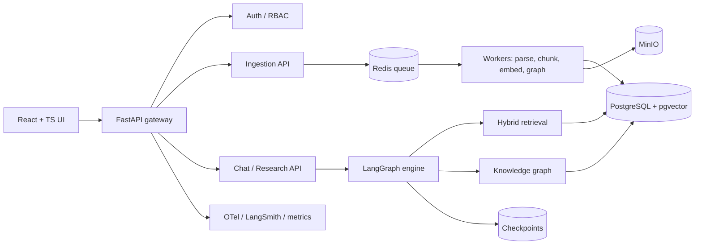

# NEXUS AI Architecture

## Retrieval-time security
Every retrieval query is built from a `Principal` (user, org, role, accessible collections). The
filter `org_id = :org AND collection_id IN (:allowed) AND is_current` is part of the SQL/vector
scan, so unauthorised chunks are never candidates.

## Ingestion data flow
upload → validate (size, extension, magic bytes) → hash → dedupe/version → store → job queued →
parse → section/page detection → parent/child chunking → embeddings → graph extraction → ready.
