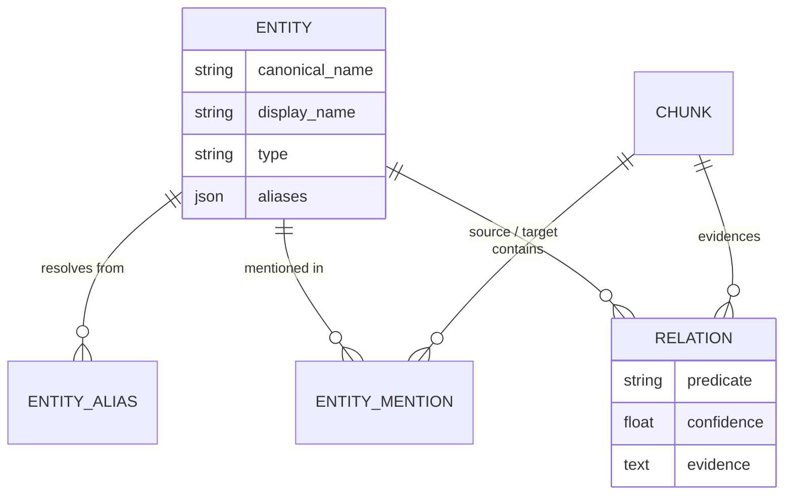

# Knowledge graph subsystem (Phase 5)

## Extraction (`RuleBasedExtractor` default, `LLMExtractor` optional)
* **Rule-based (offline):** capitalised phrases, acronyms/model names, hyphenated terms, organisations, "Name et al."
  authors; relations from a predicate lexicon (improves, extends, outperforms, based_on, uses, proposes, evaluated_on,
  limited_by, compared_with, part_of) between nearby mentions, passive voice swapped, co-occurrence as `related_to` at
  confidence 0.3. Precision-oriented; it **misses non-hyphenated lowercase concepts** (add a gazetteer or use the LLM).
* **LLM:** output is untrusted. An entity must literally occur in the chunk; a relation must quote a verbatim sentence of
  the chunk containing both endpoints; predicates are mapped to the closed vocabulary; self-loops and over-cap items are
  dropped. A hallucinating or prompt-injected model therefore cannot add facts the document does not contain.
  Cost: one LLM call per chunk at ingestion.

## Resolution (`EntityResolver`)
Canonical form = NFKC, lower-case, hyphen/underscore→space, punctuation and possessive stripped, leading article and legal
suffix removed, light plural folding. Order: in-batch cache → exact canonical/alias match → conservative fuzzy match
(same type, ≥ 6 chars, difflib ≥ 0.94) → create. Acronym definitions `Expansion (ACR)` found in a document unify the
acronym and expansion for that document and, through the alias table, for every later document in the organisation.
Entities are never shared across organisations.

## How the graph is updated when documents are uploaded
1. The ingestion job parses, chunks and embeds the new version (as in Phase 2).
2. **Extraction runs first and writes nothing.** If it fails (e.g. LLM outage) the document still becomes searchable,
   `meta.graph.status = "failed"` is recorded, and `POST /graph/reindex/{id}` re-runs it later.
3. On success, in the **same transaction as the version swap**: all mentions/relations previously stored for the
   document are deleted, entities left with no mention are garbage-collected, then entities, aliases, mentions and
   relations are rebuilt from the new chunks. The graph therefore always reflects the *current* version; older versions
   remain reachable via temporal vector/keyword search only.
4. Deleting a document clears its graph contributions the same way.

## Graph-assisted retrieval (`GraphRetriever`, `plan.graph`)
Query → n-gram match against entity aliases (longest match wins) → seed entities → bounded BFS (default depth 2, at most
`graph_max_edges_per_hop` edges per hop, highest confidence first) → evidence chunks scored 1.0 (+0.25 per additional
seed) for seed mentions and `(0.5 + 0.5·conf)/depth` for relation evidence. The ranking is fused with the other
retrievers by RRF and a bounded bonus (0.25 × graph score) keeps graph evidence from being reranked away when it shares
no words with the query. Every edge carries its evidence sentence, document title and page for citation.

**Security:** all graph queries join the same `build_scope` used by vector/keyword retrieval. An entity is visible only
through a readable mention, and an edge is followed only if its evidencing chunk is readable, so restricted documents
contribute no nodes, edges or chunks to unauthorised users (tested on SQLite and PostgreSQL). Entity detail for a hidden
or foreign entity returns 404.

## Limitations
* Rule-based recall is limited and unmeasured; extraction quality and graph-retrieval gains are **not yet evaluated** (Phase 9).
* Fuzzy resolution can still mis-merge look-alike names; thresholds are untuned.
* Relation direction/predicate for rule extraction is lexical; negation ("does not improve") is not handled.
* Co-occurrence edges (`related_to`, 0.3) add noise on dense text; they are down-weighted but not removed.
* BFS is per-query SQL; very high-degree hubs rely on the per-hop edge cap. No graph-database backend is used.
