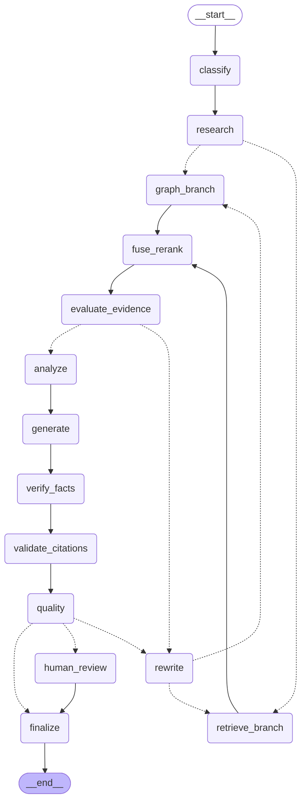

# LangGraph multi-agent workflow (Phase 6)

The diagram below is generated from the compiled graph (`infrastructure/scripts/export_workflow_diagram.py`); dashed
edges are conditional. Source: `backend/app/workflows/research_graph.py`.

## Agents and what they actually do
| Agent | Nodes | Responsibility (implemented) |
|---|---|---|
| 1 Orchestrator | `classify`, `finalize` | Rule-based query classification and intent, builds the escalation ladder (adaptive plan), selects specialist agents, finalises status; streams only the *verified* answer |
| 2 Research | `research`, `rewrite` | Contextual rewrite of follow-ups from conversation history, decomposition, query variants, HyDE; on insufficient evidence escalates the plan one level and widens the query set |
| 3 Retrieval | `retrieve_branch` ×N (parallel `Send`), `fuse_rerank` | Scoped hybrid retrieval per sub-query, RRF across queries, rerank (max over sub-questions) |
| 4 Knowledge graph | `graph_branch` | Multi-hop graph retrieval in parallel with the keyword/vector branches; brought in on retry for every query class |
| 5 Analytical | `analyze` | Sanitises passages (injection filter), then per-document comparison, quantitative findings, timeline, version notes, numeric/polarity **contradiction candidates** (heuristic) |
| 6 Verification | `verify_facts`, `validate_citations` | Per-claim support check (content-word coverage + every number must appear in the cited passages + optional LLM judge that can only downgrade), removes unsupported claims, qualifies weak ones, validates and renumbers citations, attaches verbatim quotes |
| 7 Report generation | `generate` | Drafts atomic claims with passage citations (LLM, with deterministic extractive fallback); the draft is never shown unverified |
| 8 Quality control | `evaluate_evidence`, `quality` | Evidence sufficiency before analysis; relevance/completeness/groundedness/citation coverage after verification; decides retrieve-more / human review / done |
| Human | `human_review` | `interrupt()` with the full review payload; resume = approve / edit / reject |

## State, persistence and resumption
* `ResearchState` is a typed dict with reducers for `branches`, `trace`, `errors` and `llm_usage`. It contains only
  JSON-serialisable values; services are captured by closure, never stored in state.
* Checkpoints use `AsyncSqliteSaver` (file path `NEXUS_CHECKPOINT_PATH`; `:memory:` in tests). `thread_id` = run id. A run
  interrupted for review can be resumed by a **different process** after a restart (tested). A PostgreSQL checkpointer
  (`langgraph-checkpoint-postgres`) is the intended production backend and is **not yet implemented** (Phase 10).
* Checkpoints contain the question, evidence text and answer. Deleting a conversation deletes its runs' checkpoints.

## Control flow guarantees (each tested)
* **Loop cap:** evidence-insufficiency and quality-driven retries share one counter bounded by `max_retrieval_loops`
  (checked in both routing functions); caps 0, 1, 2 produce exactly that many rewrites.
* **Retries and errors:** retrieval/graph/LLM nodes have `RetryPolicy(max_attempts=3, exponential backoff)` for
  network/IO errors only. Exhausted retries fail the run cleanly (`502 workflow_failed`, run row `failed`). Other agent
  failures are caught per node, recorded in `errors`, and the run degrades to an "insufficient evidence" answer rather
  than an ungrounded one.
* **Authorisation:** every data-touching node re-reads the run owner from the database (active, same org); retrieval
  scope is rebuilt from the live record. Resume is allowed for the run owner or an org admin; the reviewer id is set by
  the server. Clients can request *more* review (`review: always`), never less. Foreign runs/conversations return 404.
* **Prompt injection:** instruction-like sentences are removed from evidence before generation; passages are delimited
  data; claims must be supported by cited passages, so even an obeyed injection cannot reach the answer (tested with a
  hostile model).

## API
`POST /chat` (JSON or `stream: true` → Server-Sent Events: `run`, `agent`, `evidence`, `review_required`, `delta`, `done`,
`error`), `GET /agents/runs`, `GET /agents/runs/{id}` (state inspection: trace, plan, evidence, pending review),
`POST /agents/runs/{id}/resume[?stream=true]`, `GET /conversations`, `GET /conversations/{id}/messages`,
`DELETE /conversations/{id}`.

## Known limitations (measured or observed, not hypothetical)
* **Heuristic gates are uncalibrated.** In a smoke run on a 4-document corpus the answer was already grounded at loop 0,
  yet the workflow used both escalation loops because evidence confidence (0.30) was below the 0.35 threshold and the
  lexical *completeness* metric scored paraphrased answers 0. Escalation therefore costs latency/LLM calls without
  proof of benefit until calibrated (Phase 9).
* **Backend sensitivity:** the same query scored evidence confidence 0.23 on PostgreSQL (FTS ranking) but higher on
  SQLite (BM25), crossing the 0.25 auto-review threshold. Thresholds must be calibrated per backend.
* Verification is lexical + optional LLM judge; paraphrases may be rejected (false negatives) and a clever paraphrase
  with matching words but different meaning could pass the lexical gate (the LLM judge is the mitigation).
* Contradiction detection is a heuristic over sentence pairs and reports candidates only.
* The offline `MockLLM` answers extractively; it validates plumbing, not answer quality.
* SQLite is used for checkpoints; concurrent workers on one SQLite file are not supported.
